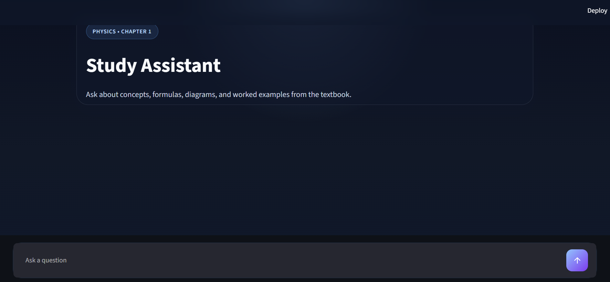
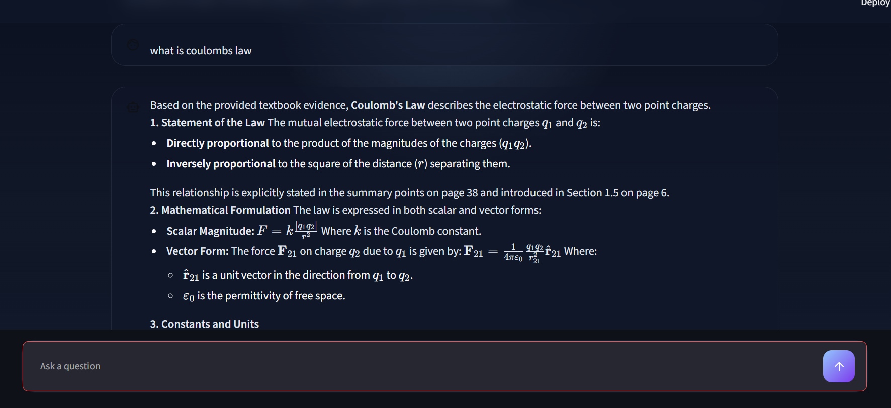

# Multimodal CBSE Study Assistant


A textbook-grounded study assistant for Class 12 Physics. It retrieves both extracted textbook text and full-page visual descriptions, then uses the retrieved evidence to answer student questions. The application combines a **FastAPI backend**, **Streamlit interface**, **Qdrant vector database**, **LangGraph workflow**, and a deterministic calculator for a supported numerical question.

> **Current scope:** The knowledge base contains a Class 12 Physics Chapter 1 vertical slice — **Electric Charges and Fields**. It is not a complete CBSE curriculum index.

## Contents

- [Application Preview](#application-preview)
- [What the Project Does](#what-the-project-does)
- [Architecture](#architecture)
- [Knowledge Base and Retrieval](#knowledge-base-and-retrieval)
- [Query Handling](#query-handling)
- [Numerical Questions](#numerical-questions)
- [Run the Project](#run-the-project)
- [Evaluation](#evaluation)
- [Tests](#tests)
- [Project Structure](#project-structure)
- [Configuration and Safety](#configuration-and-safety)

## Application Preview

The interface provides a chat-based way to ask questions about the indexed textbook chapter.

**Study assistant — initial screen**



**Example — asking about Coulomb's law**



## What the Project Does

Text-only retrieval can miss information that textbooks communicate through diagrams, equations, graphs, tables, worked examples, and page layout. This project indexes extracted page text alongside descriptions of complete textbook pages, allowing text-based and visual questions to follow the same retrieval workflow.

Students can:

- Ask questions about concepts and explanations in the textbook.
- Ask follow-up questions using recent conversation context.
- Compare multiple concepts or textbook topics.
- Request study guidance.
- Calculate the electric-field magnitude of a point charge using the supported calculator.

When textbook retrieval is used, the response can include the source file, page number, record type, and available textbook page image.

### Main Features

- Textbook-grounded question answering using text and full-page visual/page records.
- LangGraph orchestration with intent routing, conditional edges, and evidence checks.
- LangChain integrations for `ChatGroq`, `HuggingFaceEmbeddings`, and `QdrantVectorStore`.
- Conversation-aware follow-up rewriting.
- Multi-concept query decomposition, limited to three subqueries.
- Evidence sufficiency checks and a bounded retrieval retry.
- Bounded retries for transient Groq connection and time-out errors.
- Lightweight lexical-plus-dense reranking and round-robin result merging with deduplication.
- Deterministic electric-field calculation for a point charge.
- Page-level source metadata in API and UI responses.
- FastAPI `/query` and `/health` endpoints, Streamlit UI, and Docker Compose setup.
- Deterministic tests and two evaluation runners.

## Architecture

### Online query path

```text
Student
   |
   v
Streamlit UI
   |
   v
FastAPI /query
   |
   v
Study Assistant Orchestrator
   |
   v
LangGraph StateGraph
   |
   +--> route
   +--> rewrite_followup / decompose
   +--> retrieve
   +--> rerank_merge
   +--> evidence_check -- retry available --> retrieve
   +--> calculate / generate
   |
   v
LangChain QdrantVectorStore + HuggingFaceEmbeddings
   |
   v
ChatGroq answer generation
   |
   v
Answer + sources + available page images
```

The orchestrator supplies the graph state for each request. There is no graph checkpointer or persistent graph memory; recent conversation history is passed into the request state. LangGraph handles orchestration and conditional edges. The lexical+dense reranker, round-robin merge/deduplication, and calculator are custom application logic rather than framework features.

### Ingestion path

PDF processing is separate from the online query path:

```text
Textbook PDF files
   |
   +--> pypdf page-text extraction
   +--> PyMuPDF full-page PNG rendering
   +--> ChatGroq vision descriptions for each page
   |
   v
Text chunks + full-page records
   |
   v
BAAI/bge-base-en-v1.5 embeddings
   |
   v
Qdrant collection
```

## Knowledge Base and Retrieval

The current processed material is the Class 12 Physics chapter `chapter_01_electric_charges_and_fields`.

Ingestion creates two record types:

- **`text` records:** cleaned, page-aware text chunks.
- **`page` records:** generated descriptions of complete textbook pages, together with the rendered PNG path.

Records retain metadata such as page number, source file, record type, document ID, and chunk ID. The current ingestion code processes complete pages; it does **not** crop individual figures into separate image records.

### Retrieval workflow

1. Read textbook PDFs from `data/raw`.
2. Extract page text with `pypdf` and render each page as a PNG with PyMuPDF.
3. Use the configured ChatGroq vision model to describe page-level visual content.
4. Create overlapping text chunks and one page record per page.
5. Embed the records with `BAAI/bge-base-en-v1.5` and index them in Qdrant.
6. Invoke the compiled LangGraph workflow with the user message and conversation history.
7. Retrieve the configured top-k records for each search query through LangChain's Qdrant vector store and Hugging Face embedding integration.
8. Retrieve a bounded candidate pool slightly larger than top-k, then rerank it using dense similarity and lightweight lexical query-token overlap. Dense similarity remains dominant, and source/page provenance is preserved.
9. Merge decomposed-query results round-robin, remove duplicates, and assess whether the evidence is usable.
10. When evidence is unusable, retry retrieval once with a normalized textbook-context suffix.
11. Generate an evidence-grounded response or return an explicit insufficient-evidence response.
12. Return source metadata and available page images through the API and UI.

The reranker is **not BM25** and does not use a separate reranker model. The reranking, result merge/deduplication, evidence assessment, and electric-field calculator are custom application logic, not LangChain or LangGraph features.

The Streamlit UI displays returned page images when they are available locally.

## Query Handling

### Intent routing

LangGraph uses a structured router built with LangChain `ChatGroq` JSON-mode output. It selects among five supported intents:

- `casual_chat`
- `textbook_question`
- `follow_up_question`
- `calculation`
- `study_guidance`

Obvious greetings and acknowledgements are handled without an LLM router call. Routing, follow-up rewriting, decomposition, retrieval, evidence checking, calculation, and generation are implemented as graph nodes around the application's operations.

### Follow-up questions

Recent conversation history can be used to rewrite a follow-up into a standalone retrieval query. For example:

```text
Student: What is electric flux?
Follow-up: Explain that again.
```

Only the recent, bounded history configured by the application is used; this is not unlimited or persistent memory.

### Multi-concept questions

A question involving multiple concepts can be split into up to three independent retrieval queries. For example, a comparison of point-charge and dipole field diagrams can produce separate searches. Results are interleaved so that one subquery does not occupy the entire top-k context.

### Evidence checks and retries

Retrieved records are checked for usable text or page-image evidence. The evidence-check edge allows a maximum of two retrieval attempts. If the evidence is still insufficient, the graph returns an explicit insufficient-evidence response rather than presenting unsupported information as textbook content.

Main Groq calls also retry transient connection and time-out failures at most twice, with short backoff. Rate-limit errors remain explicit failures.

## Numerical Questions

The deterministic calculator currently supports electric-field magnitude for a point charge:

```text
E = k |q| / r²
```

It parses charge units including `C`, `mC`, `μC`, `µC`, `uC`, and `nC`, and distance units including `m`, `cm`, and `km`. It returns a structured success or failure result. It does not execute arbitrary code or claim to support every Physics formula.

## Run the Project

### 1. Set up the environment

The commands below use Windows PowerShell:

```powershell
python -m venv .venv
.venv\Scripts\Activate.ps1
python -m pip install -r requirements.txt
Copy-Item .env.example .env
```

Set the following values in `.env`:

```text
GROQ_API_KEY=your_groq_api_key
QDRANT_URL=your_qdrant_url
QDRANT_API_KEY=your_qdrant_api_key
```

Model, collection, and top-k settings can also be configured there.

### 2. Build the local knowledge base

Place the textbook PDF under `data/raw`, then run:

```powershell
python scripts\ingest.py --chapter class_12_physics_part01\chapter_01_electric_charges_and_fields.pdf
python scripts\index.py
```

Ingestion writes processed records and page images under `data`. These generated textbook artifacts are local data and are excluded from the public repository by `.gitignore`.

### 3. Start the application locally

Start the API in one terminal:

```powershell
python -m uvicorn api.main:app --host 127.0.0.1 --port 8000
```

Start the Streamlit interface in another terminal:

```powershell
streamlit run app\streamlit_app.py
```

The API is available at `http://localhost:8000` and the UI at `http://localhost:8501`.

### 4. Run with Docker Compose

```powershell
docker compose up --build
```

Compose starts separate API and UI containers. The UI uses `http://api:8000` as its internal API URL.

## Evaluation

The project includes two evaluation runners:

- `scripts/evaluate.py` runs the original five-question Chapter 1 benchmark in `data/evaluation/benchmark_chapter_01.json`.
- `scripts/evaluate_agentic.py` runs the 24-case benchmark in `evaluation/benchmark.json`. It covers routing, follow-ups, decomposition, visual questions, calculations, insufficient evidence, citations, and end-to-end success.

Run the deterministic tests and evaluations with:

```powershell
python -m pytest -q
python -m scripts.evaluate
python -m scripts.evaluate_agentic
```

### Evaluation methodology

The agentic evaluator is a **custom repository-local evaluation harness**; it does not use RAGAS or DeepEval.

```text
24 benchmark cases
        ↓
run routing, retrieval, orchestration, and answer generation
        ↓
retrieval and citation checks
        ↓
agentic behavior checks
        ↓
answer scoring where a reference answer exists
        ↓
aggregate metrics
```

Retrieval metrics use the 13 cases with expected source pages and are calculated at page level. Duplicate records from the same page count once. Precision@k uses relevant unique pages in the first k divided by k; Recall@k divides by the number of expected pages; Hit@k checks whether any expected page appears. MRR is the reciprocal rank of the first relevant unique page, and nDCG@5 uses binary page relevance and unique-page ranks.

Context Precision and Context Recall are page-level context proxies, not semantic context judgments. Citation Accuracy checks whether an expected page is cited. Follow-up Resolution and Contextual Retrieval Success use the three follow-up cases.

Correctness and Groundedness are LLM-judge scores from 1 to 5, averaged only over the eight completed cases in the current run that contain a reference answer. They are not scores for all 24 cases. End-to-End Success is a case-level boolean over all 24 cases and includes routing, retrieval, abstention, calculation, decomposition, answer, and citation requirements where applicable.

### Latest recorded results

The table below reproduces the values from the current-code live run. The artifact contains 24 records: 21 completed cases and three unavailable cases after Groq rate-limit failures. Unavailable cases do not receive metric scores.

| Category | Metric | Result | Evaluation scope |
|---|---|---:|---|
| Retrieval | Precision@3 | 20.5% | 13 page-grounded cases |
| Retrieval | Precision@5 | 16.9% | 13 page-grounded cases |
| Retrieval | Recall@3 | 50.0% | 13 page-grounded cases |
| Retrieval | Recall@5 | 69.2% | 13 page-grounded cases |
| Retrieval | Hit@3 | 53.8% | 13 page-grounded cases |
| Retrieval | Hit@5 | 69.2% | 13 page-grounded cases |
| Retrieval | MRR | 46.2% | 13 page-grounded cases |
| Retrieval | nDCG@5 | 52.4% | 13 page-grounded cases |
| RAG context | Context Precision | 16.9% | 13 page-level context proxies |
| RAG context | Context Recall | 69.2% | 13 page-level context proxies |
| RAG context | Context Relevancy | 5.00 / 5 | 8 completed LLM-judge cases |
| Generation | Answer Correctness | 5.00 / 5 | 8 completed reference-answer cases; LLM judge |
| Generation | Faithfulness / Groundedness | 5.00 / 5 | 8 completed reference-answer cases; LLM judge |
| Generation | Answer Relevancy | 5.00 / 5 | 8 completed LLM-judge cases |
| Citation | Citation Accuracy | 61.5% | 13 expected-page cases |
| Citation | Citation Completeness | 5.00 / 5 | 8 completed LLM-judge cases |
| Agent | Intent Accuracy | 95.2% | 21 completed cases |
| Agent | Follow-up Resolution | 100.0% | 3 follow-up cases |
| Agent | Decomposition Decision Accuracy | 100.0% | 2 multi-concept cases |
| Agent | Concept Coverage | 100.0% | 2 multi-concept cases |
| Agent | Calculation Accuracy | 100.0% | 2 completed numerical cases |
| Agent | Unsupported-query Abstention Success | Unavailable | All 3 insufficient-evidence cases hit rate limits |
| Agent | End-to-End Success | 70.8% | 17/24 records; unavailable cases count as unsuccessful |
| Multimodal | Visual Page Retrieval Hit@5 | 83.3% | 6 visual-evidence cases |
| Multimodal | Visual Evidence Groundedness | 5.00 / 5 | 3 visual cases; LLM judge |
| System | Mean latency | 28.08 s | 24 current-run records |
| System | Median latency | 26.08 s | 24 current-run records |
| System | P95 latency | 59.78 s | 24 current-run records |
| System | Min / Max latency | 0.76 / 61.65 s | 24 current-run records |
| System | Query failure rate | 12.5% | 3/24 rate-limit failures |

Unsupported-query abstention success means that, for an insufficient-evidence case, the generated answer explicitly states that the available evidence is insufficient. Its denominator is the three insufficient-evidence cases; it is not an unsupported-answer rate. That metric is unavailable because all three cases encountered rate limits.

These results include the lightweight retrieval reranker. The three insufficient-evidence cases were unavailable because Groq rate limits were reached during answer generation; no scores were imputed for them. LLM-judge values are automated judgments, not human evaluations.

The benchmark is a small, 24-case evaluation of one chapter. It is useful for checking the current implementation, but it is too small to support statistically robust or production-wide performance claims. The results are not claims about the full CBSE curriculum. Detailed reports are written to `data/evaluation/results.json` and `data/evaluation/agentic_results.json`.

### Latency note

Each online query records `total_latency_ms` in the orchestrator debug payload using Python's `time.perf_counter()`. The stored benchmark artifact also contains per-case `latency_ms`; those values include the configured live evaluation path and should not be treated as portable performance guarantees.

In a separate five-query local API smoke test, the observed median end-to-end latency was **4.87 seconds per query**. This is a small local measurement, not a production benchmark. Latency varies with Groq response time, Qdrant/network conditions, and the deployment environment.

### Evaluation limitations

- The benchmark covers one Class 12 Physics chapter and 24 structured cases.
- Stored results are a snapshot of one configured run.
- Correctness and groundedness use an LLM judge, not human evaluation.
- Three cases in the recorded run were unavailable because of Groq rate limits.
- Latency depends on Groq, Qdrant, network conditions, and local configuration.
- A broader multi-chapter benchmark and repeated live runs are needed for stronger statistical confidence.

## Tests

The test suite covers:

- Text cleaning, chunking, IDs, and citations.
- Calculator parsing and deterministic results.
- Query routing, follow-up rewriting, decomposition, and orchestration.
- Transient Groq retry behavior.
- Evaluation metrics and benchmark provenance.
- Diversified merge ordering, bounds, and deduplication.

The current local suite has **46 passing tests**.

## Project Structure

```text
MultiModal_RAG/
├── api/
│   └── main.py                     # FastAPI application
├── app/
│   └── streamlit_app.py             # Streamlit chat UI
├── data/                            # Local raw, processed, and evaluation data
├── evaluation/
│   └── benchmark.json               # Agentic benchmark
├── scripts/
│   ├── ingest.py                    # PDF ingestion
│   ├── index.py                     # Qdrant indexing
│   ├── evaluate.py                  # Baseline evaluation
│   ├── evaluate_agentic.py          # Agentic evaluation
│   └── smoke_test.py                # Chapter vertical-slice check
├── src/study_assistant/
│   ├── agent.py                     # Routing, rewriting, decomposition
│   ├── calculator.py                # Electric-field calculator
│   ├── chunking.py                  # Text cleanup and chunk records
│   ├── embeddings.py                # Sentence-transformer embeddings
│   ├── generation.py                # Grounded answer generation
│   ├── ingest.py                    # PDF, text, and page processing
│   ├── orchestrator.py              # End-to-end query workflow
│   ├── retrieval.py                 # Qdrant search
│   └── visual_understanding.py      # Full-page visual descriptions
├── tests/
├── Dockerfile.api
├── Dockerfile.ui
├── docker-compose.yml
├── .env.example
└── requirements.txt
```

## Configuration and Safety

Copy `.env.example` to `.env` and keep credentials local. The application expects Groq and Qdrant credentials through environment variables; credentials should not be stored in source files.

Do not commit `.env`, API keys, downloaded textbooks, generated page images, processed records, or local evaluation artifacts. The generated textbook data is intended to remain local and is excluded from the public repository by `.gitignore`.
